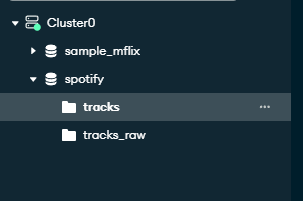
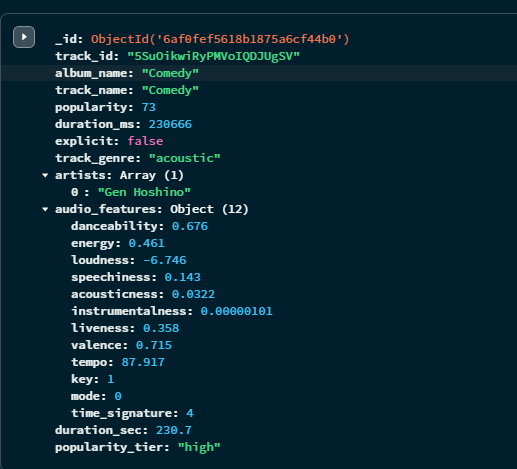
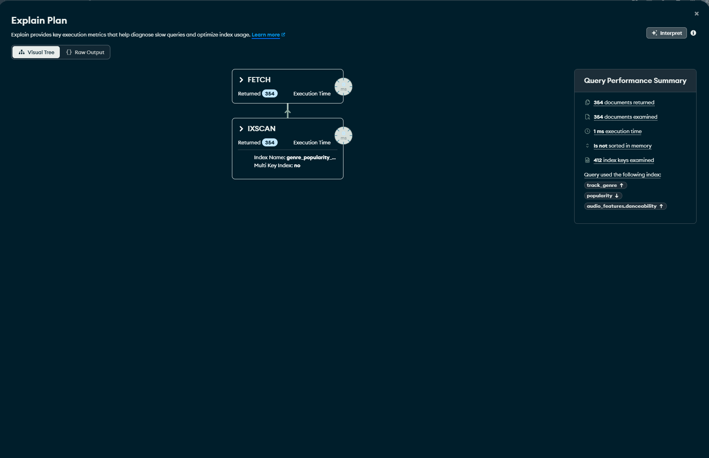
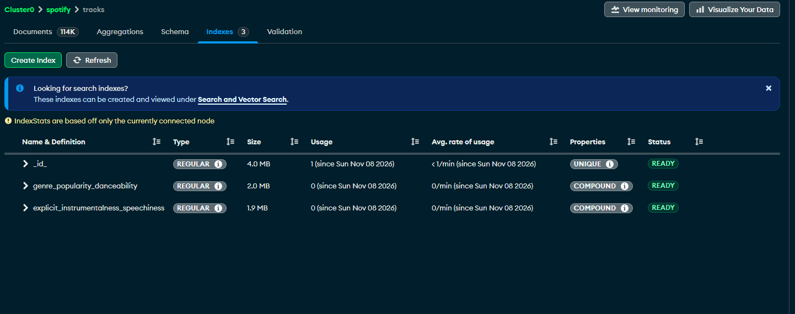

# Zharun_nosql_1 — аналітика Spotify на MongoDB

Домашнє завдання 1, 
Датасет [Spotify Tracks](https://www.kaggle.com/datasets/maharshipandya/-spotify-tracks-dataset) 

## Структура

```
scripts/01_load_data.py     CSV → spotify.tracks_raw
scripts/02_transform.js     tracks_raw → tracks (Aggregation Pipeline)
queries/part2_queries.js    запити частини 2
queries/part3_indexes.js    індекси та explain() (частина 3)
results/                    вивід скриптів
screenshots/                скріншоти Atlas
```

## Запуск

1. Atlas: кластер **M0**, користувач бази, свій IP у Network Access, рядок підключення з **Connect → Drivers**.
2. Середовище та дані:
   ```bash
   python -m venv .venv
   source .venv/bin/activate            # Windows (Git Bash): source .venv/Scripts/activate
   pip install -r requirements.txt
   cp .env.example .env                 # вписати MONGO_URI=mongodb+srv://...
   # dataset.csv з Kaggle покласти в корінь проєкту
   ```
3. Скрипти (усі ідемпотентні — можна перезапускати):
   ```bash
   set -a; source .env; set +a
   python scripts/01_load_data.py
   mongosh "$MONGO_URI" --file scripts/02_transform.js
   mongosh "$MONGO_URI" --quiet --file queries/part2_queries.js > results/part2_output.txt
   mongosh "$MONGO_URI" --quiet --file queries/part3_indexes.js > results/part3_output.txt
   ```
   Якщо `mongosh` є лише в Docker-контейнері: `docker cp <файл> mongodb_dev:/tmp/`, потім `docker exec mongodb_dev mongosh "$MONGO_URI" --quiet --file /tmp/<файл>`. Передавати файл через `<` не можна: `mongosh` тоді виконує його рядок за рядком як консоль і ламається на рядках, що починаються з `.`.

---

## Частина 1. Схема даних

`01_load_data.py` приводить типи (`explicit` → bool, числа → int/float), відкидає 1 рядок без виконавця і назви та вставляє батчами по 1000 → **113 999** документів у `tracks_raw`.

`02_transform.js`: `$project` → `$split` + `$trim` (рядок виконавців → масив) → `$addFields` (`audio_features`, `duration_sec`, `popularity_tier`) → `$unset` → `$out: "tracks"`.

```json
{
  "track_id": "5SuOikwiRyPMVoIQDJUgSV",
  "track_name": "Comedy",
  "artists": ["Gen Hoshino"],
  "popularity": 73,
  "explicit": false,
  "track_genre": "acoustic",
  "audio_features": { "danceability": 0.676, "energy": 0.461, "tempo": 87.917, "...": "12 полів" },
  "duration_sec": 230.7,
  "popularity_tier": "high"
}
```

**Особливість даних:** 16 641 `track_id` повторюються в кількох жанрах (один трек = кілька документів). Це важливо для підрахунку треків у частині 2.

### Чому `audio_features` — вкладений об'єкт?

12 характеристик — одна сутність («як звучить трек»), відношення 1:1, розмір фіксований, у запитах вони потрібні разом. Вкладення відділяє їх від метаданих, дозволяє одним полем взяти або сховати весь профіль і віддати його в ML як вектор ознак.

**Мінуси:** довгі шляхи (`"audio_features.energy"` — лише в лапках, помилка в шляху мовчки дає 0 результатів). Порівняння об'єкта цілком (`{audio_features: {energy: 0.8}}`) не працює. Документ більший на 14% (462 → 526 байтів). Для даних, що ростуть без меж або часто змінюються окремо, краща окрема колекція.

### Чому `artists` — масив?

MongoDB порівнює значення з кожним елементом масиву:

| Запит | Результат |
|---|---|
| `{ artists: "Drake" }` (масив) | 50 — точно Drake |
| `{ artists: /Drake/ }` (рядок) | 66 — разом з «Nick Drake» |
| `{ artists: "Future" }` / `/Future/` | 25 / 72 («Future Funk Squad», «Future Palace»…) |

Масив також дає оператори `$all` (спільні треки), `$size` (сольні), `"artists.0"` (головний виконавець), `$unwind` для агрегацій по виконавцях і multikey-індекс. Regex по рядку індекс не використовує.

---

## Частина 2. Запити

Результати звірено з незалежним підрахунком у pandas — збігаються повністю.

### 2.1. Треки для вечірки

```javascript
db.tracks.find({
  "audio_features.danceability": { $gt: 0.7 },
  "audio_features.energy": { $gt: 0.7 },
  duration_ms: { $gte: 180000, $lte: 300000 }
}).sort({ popularity: -1 })
```

«Вище 0.7» → `$gt`; «від 3 до 5 хв» → межі включно. Фільтр за `duration_ms`, а не за округленим `duration_sec`: інакше потрапив би 31 трек тривалістю 179.95–179.99 с.

**Результат:** 7 311 документів (5 328 унікальних треків). Топ — «Calm Down» (Rema, Selena Gomez), 92.

### 2.2. Виконавці, у яких усі треки популярні

```javascript
db.tracks.aggregate([
  { $group: { _id: "$track_id", artists: { $first: "$artists" }, popularity: { $min: "$popularity" } } },
  { $unwind: "$artists" },
  { $group: { _id: "$artists", track_count: { $sum: 1 },
              min_popularity: { $min: "$popularity" }, avg_popularity: { $avg: "$popularity" } } },
  { $match: { track_count: { $gte: 3 }, min_popularity: { $gte: 60 } } },
  { $sort: { avg_popularity: -1, track_count: -1, _id: 1 } },
  { $limit: 20 }
])
```

Перший `$group` прибирає повтори треків між жанрами. `$unwind` зараховує колаборацію кожному виконавцю. `$match` після `$group` — аналог `HAVING`.

**Результат:** 170 артистів. Топ-5: Harry Styles (3 треки, мін. 89, сер. 92.0), Olivia Rodrigo (5 / 86 / 87.4), IVE (3 / 79 / 84.0), Morgan Wallen (3 / 81 / 83.3), One Direction (5 / 80 / 83.0).

**Без дедуплікації** виходить 334 артисти, а «Luar La L» посідає 2-ге місце з «4 треками», хоча в нього один трек («Caile»), записаний у 4 жанрах.

### 2.3. Нетипові треки (tempo > середнє жанру + 2σ)

```javascript
db.tracks.aggregate([
  { $group: { _id: "$track_genre",
      avg_tempo: { $avg: "$audio_features.tempo" },
      std_tempo: { $stdDevPop: "$audio_features.tempo" },
      tracks: { $push: { _id: "$_id", track_name: "$track_name", popularity: "$popularity",
                         artists: "$artists", audio_features: { tempo: "$audio_features.tempo" } } } } },
  { $addFields: { outlier_threshold: { $add: ["$avg_tempo", { $multiply: [2, "$std_tempo"] }] } } },
  { $addFields: { outlier_tracks: { $filter: { input: "$tracks", as: "t",
      cond: { $gt: ["$$t.audio_features.tempo", "$outlier_threshold"] } } } } },
  { $match: { "outlier_tracks.0": { $exists: true } } },
  { $project: { _id: 0, avg_tempo: { $round: ["$avg_tempo", 1] }, genre: "$_id",
                outlier_threshold: { $round: ["$outlier_threshold", 1] }, outlier_tracks: 1 } }
])
```

Один `$group` рахує статистику жанру і зберігає його треки. `$filter` порівнює кожен трек з порогом його жанру (неокругленим). `$stdDevPop`, бо 1000 треків жанру — уся сукупність.

**Результат:** 3 506 треків у 112 жанрах. `acoustic`: середнє 119.0, поріг 178.5, 34 треки — збігається з прикладом з умови.

**Спостереження:** у `drum-and-bass` поріг 218 BPM вищий за найшвидший трек (184 BPM). Темп там двогорбий (174 і «половинний» 87), тому правило «mean + 2σ» не працює.

### 2.4. Музика для фонової роботи

```javascript
db.tracks.find({
  "audio_features.loudness": { $lt: -10 },
  "audio_features.speechiness": { $lt: 0.1 },
  "audio_features.instrumentalness": { $gt: 0.5 },
  explicit: false
})
```

Умови поєднуються неявним `$and`. `loudness` від'ємна (дБ), тож «тихий» = `$lt: -10`.

**Результат:** 9 324 документи. Найчастіші жанри: `new-age`, `sleep`, `ambient`, `classical`, `piano`. У топ потрапила пісня з вокалом («everything i wanted», instrumentalness 0.657) — ці поля є оцінками моделі Spotify, а не фактом.

---

## Частина 3. Індекси

Ознаки використання індексу в `explain("executionStats")`: стадія `IXSCAN` замість `COLLSCAN`, заповнене поле `indexName`, `totalDocsExamined ≈ nReturned`, відсутня стадія `SORT`.

### 3.1. `pop` + danceability ≥ 0.7, сортування за popularity

```javascript
db.tracks.createIndex({ track_genre: 1, popularity: -1, "audio_features.danceability": 1 })
```

Порядок полів за правилом **ESR**: Equality (`track_genre`) → Sort (`popularity`) → Range (`danceability`).

| | Без індексу | Індекс ESR | Індекс E→R→S (для порівняння) |
|---|---|---|---|
| План | `SORT → COLLSCAN` | `FETCH → IXSCAN` | `FETCH → SORT → IXSCAN` |
| `totalDocsExamined` | 113 999 | **354** | 354 |
| Сортування в пам'яті | так | **ні** | так |
| Час, мс (Atlas) | 114 | 2 | 2 |

Індекс ESR зменшує кількість прочитаних документів у 322 рази й прибирає сортування в пам'яті. Коли є обидва індекси, оптимізатор обирає ESR.

### 3.2. Індекс для музики для роботи

```javascript
db.tracks.createIndex({ explicit: 1, "audio_features.instrumentalness": 1, "audio_features.speechiness": 1 })
```

`explicit` — рівність, тому першим. Далі діапазон, який сильніше звужує вибірку: `instrumentalness > 0.5` лишає 16.5% колекції, `speechiness < 0.1` — 80%.

| | Без індексу | З індексом |
|---|---|---|
| План | `COLLSCAN` | `FETCH → IXSCAN` |
| `totalDocsExamined` | 113 999 | 16 141 (= `nReturned`) |
| Час, мс (Atlas) | 134 | 38 |

Прискорення скромніше, ніж у 3.1, бо запит повертає 14% колекції. `loudness` з частини 2 в індекс не входить і перевіряється на стадії `FETCH`.

### 3.3. Чи покривний `find({ track_genre: "pop", popularity: { $gte: 70 } })`?

**Ні.** Поля фільтра є в індексі, але запит без проєкції повертає документ цілком (зокрема `_id`, `track_name`), тому потрібен `FETCH`.

| Проєкція | План | `totalDocsExamined` |
|---|---|---|
| немає | `FETCH → IXSCAN` | 317 |
| `{ _id: 0, track_genre: 1, popularity: 1 }` | `PROJECTION_COVERED → IXSCAN` | **0** |
| те саме без `_id: 0` | `PROJECTION_SIMPLE → FETCH → IXSCAN` | 317 |

Щоб запит став покривним, проєкція має містити лише поля індексу з явним `_id: 0`.

---

## Скріншоти Atlas






## Висновки

- Документна схема зручна, коли її структура відповідає тому, як дані читаються: `audio_features` і масив `artists` спрощують запити.
- Перед аналітикою треба перевіряти, що є «одиницею» в колекції: повтори треків між жанрами вдвічі завищують результат 2.2.
- У складеному індексі порядок полів важливіший за сам факт індексу: за ESR зникає сортування в пам'яті, а прочитаних документів 354 замість 113 999.
